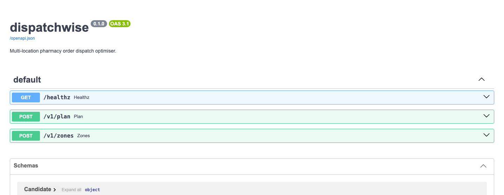
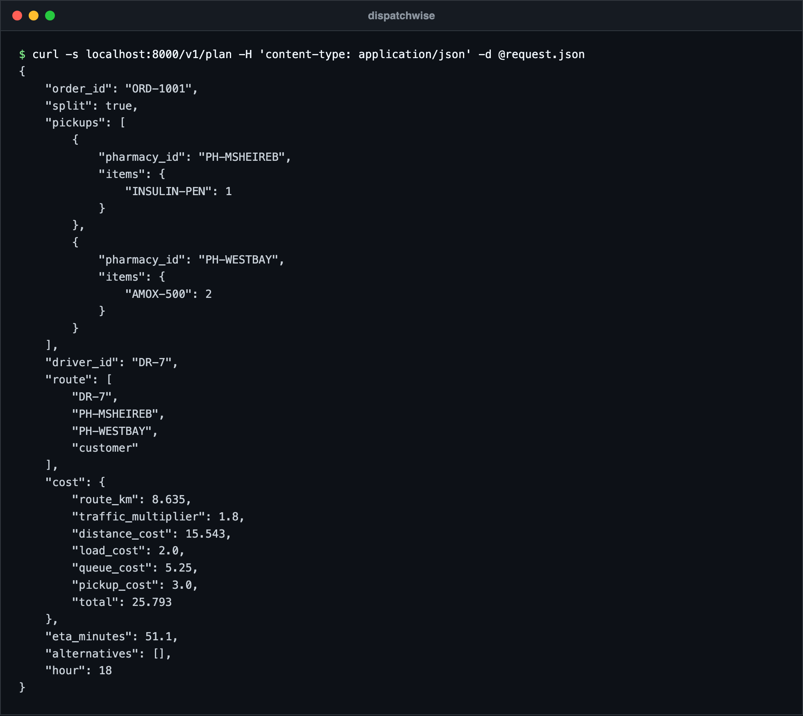
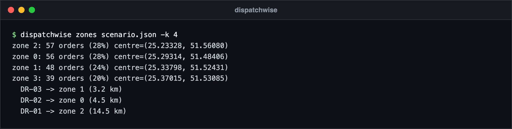
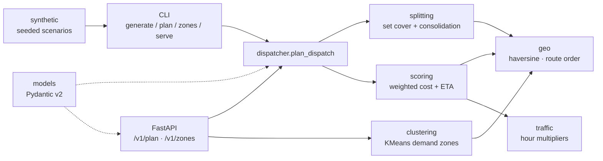

# dispatchwise


Multi-location pharmacy order dispatch optimiser. A small Python library and a stateless FastAPI service that answer one question for a delivery pharmacy network: **which pharmacies should this order be picked up from, and which driver should take it?**

Author: Ahmed Mahdy. Licence: MIT.

## Why

Pharmacy delivery is not food delivery. Stock is fragmented: a prescription with three items is often only fully available across two or three branches. A naive "nearest pharmacy, nearest driver" rule either fails the order or sends a driver on a long detour. dispatchwise makes that decision explicit, explainable and tunable:

1. **Split decision**: fulfil from one pharmacy when possible, otherwise split across the fewest pharmacies.
2. **Assignment scoring**: rank every (pickup set, driver) pair with a weighted cost that includes distance, traffic by hour, driver load and pharmacy queue.
3. **Demand zones** (optional): cluster historical orders with KMeans and suggest where idle drivers should wait.

Every plan returns a cost breakdown and ranked alternatives, so a dispatcher (human or system) can see *why* an assignment won.

## Screenshots

Output from a local run. The pharmacies, drivers and orders are made-up demo data, not production data.



The interactive docs page served at `/docs`.



A real `POST /v1/plan` call. The order needs two products no single pharmacy holds in full, so it is split across two pickups and given to driver DR-7, with the cost broken down by term.



`dispatchwise zones` on a generated 200-order scenario (seed 42): four zones and where idle drivers are sent.

## Algorithm

### 1. Split decision: greedy multi-unit set cover

```
if any pharmacy holds every line in full:
    candidates = each such pharmacy               # no split
else:
    repeat until every unit is covered:
        pick the pharmacy covering the most uncovered units
        (ties: closer to the customer, then shorter queue)
    consolidate: give each SKU to the closest chosen pharmacy
                 that holds its full quantity
```

Minimum set cover is NP-hard; the greedy rule is within a `ln(n)` factor of optimal and, for the one to three pickups real orders need, is almost always exact. The consolidation pass stops a single SKU being split "1 box here, 1 box there" when one of the chosen pharmacies can supply it whole. If the network as a whole is short of stock, the planner fails fast with the exact shortfall per SKU.

### 2. Assignment cost

For each candidate pickup set and each driver with spare capacity, the route runs from the driver through the pickups (in nearest-neighbour order) to the customer, and:

```
cost = w_distance · route_km · traffic(hour)
     + w_load     · driver.current_load
     + w_queue    · Σ pharmacy.queue_length
     + w_pickup   · (pickups − 1)

eta  = route_km / avg_speed · 60 · traffic(hour)
     + max(queue_length) · minutes_per_queued_order
```

Distances are haversine (great-circle) kilometres. `traffic(hour)` is a 24-slot multiplier profile (quiet nights, morning and evening peaks) that can be overridden per request. All weights live in `CostWeights` and are request-tunable.

### 3. Demand zones (optional extra)

Historical order coordinates are projected onto a local equirectangular plane (longitude scaled by `cos(latitude)`) so Euclidean KMeans approximates ground distance at city scale. Idle drivers are allocated to zones in proportion to demand (largest-remainder rounding), then matched to zone centres closest-pair first.

## Architecture



```
src/dispatchwise/
├── models.py       Pydantic models shared by library and API
├── geo.py          haversine, path length, nearest-neighbour ordering
├── traffic.py      hour-of-day multiplier profile
├── splitting.py    single-source check, greedy set cover, consolidation
├── scoring.py      cost breakdown and ETA for one assignment
├── dispatcher.py   plan_dispatch(): the public entry point
├── clustering.py   demand zones + driver pre-positioning (optional extra)
├── synthetic.py    reproducible demo scenarios
├── cli.py          dispatchwise generate | plan | zones | serve
└── api.py          FastAPI app
```

## Quick start

```bash
python3 -m venv .venv && source .venv/bin/activate
pip install -e ".[clustering,dev]"

dispatchwise generate -o scenario.json --orders 200 --seed 42
dispatchwise plan scenario.json --count 5 --hour 18
dispatchwise zones scenario.json -k 4
dispatchwise serve --port 8000          # http://127.0.0.1:8000/docs
```

Sample `plan` output:

```
ORD-0001: single cost=26.85 eta=61min  DR-02 -> PH-05 -> customer
ORD-0002: single cost=16.26 eta=35min  DR-03 -> PH-07 -> customer
...
200 orders, 37 split, 24 unfulfillable
```

As a library:

```python
from dispatchwise import Driver, Location, Order, OrderLine, Pharmacy, plan_dispatch

plan = plan_dispatch(order, pharmacies, drivers, hour=18)
print(plan.split, plan.route, plan.cost.total, plan.eta_minutes)
```

With Docker:

```bash
docker build -t dispatchwise .
docker run --rm -p 8000:8000 dispatchwise
```

## API

| Method | Path        | Purpose                                         |
|--------|-------------|-------------------------------------------------|
| GET    | `/healthz`  | Liveness and version                            |
| POST   | `/v1/plan`  | Plan one order: pickups, driver, cost, ETA      |
| POST   | `/v1/zones` | Cluster order points; optional driver positions |

`/v1/plan` returns `409` with a per-SKU `shortfall` when the network cannot fulfil the order, `503` when every driver is at capacity, and `422` for invalid input.

### Plan an order

```bash
curl -s localhost:8000/v1/plan -H 'content-type: application/json' -d '{
  "order": {
    "id": "ORD-1001",
    "customer": {"lat": 25.2854, "lon": 51.5310},
    "lines": [{"sku": "AMOX-500", "quantity": 2}, {"sku": "INSULIN-PEN", "quantity": 1}]
  },
  "pharmacies": [
    {"id": "PH-WESTBAY",  "location": {"lat": 25.3200, "lon": 51.5260}, "stock": {"AMOX-500": 10}, "queue_length": 2},
    {"id": "PH-MSHEIREB", "location": {"lat": 25.2867, "lon": 51.5250}, "stock": {"INSULIN-PEN": 3, "AMOX-500": 1}, "queue_length": 5},
    {"id": "PH-ALSADD",   "location": {"lat": 25.2770, "lon": 51.5040}, "stock": {"INSULIN-PEN": 4}}
  ],
  "drivers": [
    {"id": "DR-7", "location": {"lat": 25.2950, "lon": 51.5200}, "current_load": 1, "capacity": 4},
    {"id": "DR-9", "location": {"lat": 25.2600, "lon": 51.4900}, "current_load": 0, "capacity": 4}
  ],
  "hour": 18,
  "max_alternatives": 0
}'
```

```json
{
  "order_id": "ORD-1001",
  "split": true,
  "pickups": [
    {"pharmacy_id": "PH-MSHEIREB", "items": {"INSULIN-PEN": 1}},
    {"pharmacy_id": "PH-WESTBAY", "items": {"AMOX-500": 2}}
  ],
  "driver_id": "DR-7",
  "route": ["DR-7", "PH-MSHEIREB", "PH-WESTBAY", "customer"],
  "cost": {
    "route_km": 8.635, "traffic_multiplier": 1.8, "distance_cost": 15.543,
    "load_cost": 2.0, "queue_cost": 5.25, "pickup_cost": 3.0, "total": 25.793
  },
  "eta_minutes": 51.1,
  "alternatives": [],
  "hour": 18
}
```

Optional request fields: `weights` (any `CostWeights` field), `traffic` (e.g. `{"18": 2.2}` to model a match-day evening), `max_pickups`, `max_alternatives`.

### Demand zones

```bash
curl -s localhost:8000/v1/zones -H 'content-type: application/json' -d '{
  "k": 2,
  "points": [{"lat": 25.30, "lon": 51.40}, {"lat": 25.31, "lon": 51.41}, {"lat": 25.30, "lon": 51.60}],
  "drivers": [{"id": "DR-1", "location": {"lat": 25.29, "lon": 51.45}}]
}'
```

## Design decisions

- **Library first, API second.** The planner is plain functions over Pydantic models; FastAPI is a thin adapter. The same code runs in a Celery worker, a CLI or a notebook.
- **Stateless service.** Callers send the current snapshot (stock, queues, driver positions). Ownership of that state stays with the inventory and fleet systems; the optimiser never caches stale stock.
- **Greedy, not a MILP solver.** Orders have a handful of lines and the network has tens of pharmacies. A greedy cover plus exhaustive scoring of drivers is fast (about 0.5 ms per order on the demo scenario), deterministic and easy to explain to operations. A solver can replace `splitting.py` later without touching the API.
- **Explainable costs.** Each term of the cost is returned separately, so weights can be tuned against real outcomes instead of guessed.
- **Fewest pickups before shortest distance.** Every extra pickup is a handover, a wait at a counter and a chance of error; the greedy order and the `pickup` weight both encode that.
- **Optional ML.** scikit-learn is an extra (`pip install "dispatchwise[clustering]"`). The core planner has no heavy dependencies; clustering tests skip when the extra is absent.
- **What is deliberately not here:** persistence, authentication, real road routing. Those belong to the surrounding platform; a road-network ETA provider can be swapped in behind `scoring.py`.

## Running tests

```bash
pip install -e ".[dev,clustering]"
ruff check . && ruff format --check .
pytest
```

The suite covers geometry, traffic profiles, set-cover splitting (including shortfall and pickup limits), cost-driven assignment (load, queue and rush-hour effects), the synthetic generator, the CLI, clustering and the HTTP API. CI runs the same steps on Python 3.12 (`.github/workflows/ci.yml`).

## Licence

MIT © 2026 Ahmed Mahdy
